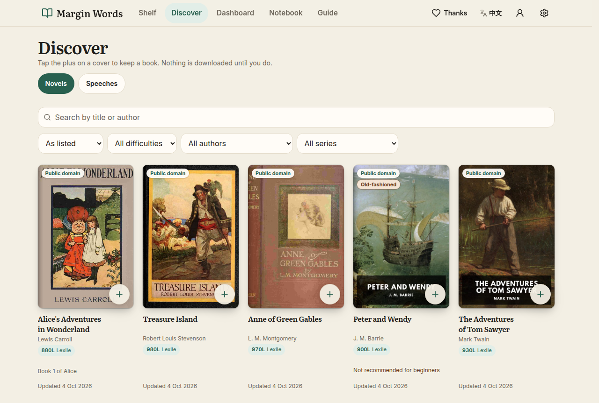

# Margin Words

[](https://inputread.site)
[](LICENSE)

> **Public repository.** Development, pushes, and pull requests happen here. The owner archived the private archive [duwqijlk/margin-words-archive](https://github.com/duwqijlk/margin-words-archive) on 2026-10-04. It is read-only and stays private. Record: [docs/ARCHIVE.md](docs/ARCHIVE.md).

A reader for English novels, made for Chinese junior-high learners. Tap a word and see a short English meaning written for that book. The buttons and menus are in **Simplified Chinese or English**. The books stay in English. There is no AI.

**[Open the reader](https://inputread.site)** · [In Chinese](README.zh-CN.md)



## About this project

Margin Words is a reader for English novels. It is made for Chinese junior-high students who are starting to read real books in English.

Tap a word in the story. A card shows a short meaning in simple English, written for that book. Notes for a paragraph, a sentence, or a phrase stay beside the text, and the page does not jump when a card opens. The buttons and menus are in Simplified Chinese or English. The novels stay in English. The reader has no AI.

A book already on the device can be read with no account and, after the first download, with no network. New books are added only from Discover, and that step needs a sign-in. Public-domain classics download from the books host. A novel that is still under copyright is not hosted here: Discover gives a word list and an ISBN, and the reader adds their own legal EPUB.

The live reader is [inputread.site](https://inputread.site). The source is publicly available under [PolyForm Noncommercial 1.0.0](LICENSE), subject to the [scope and exceptions below](#license).

## What you can do

- **Read with a meaning on the word.** Tap a word. A card shows a simple English meaning from that book's word list. A word that is not in the list says so. The card floats over the page, and the text does not move.
- **Notes beside the paragraph.** A paragraph with a note keeps a small light beside it. Sentence notes and phrases open from the text in the same way.
- **A shelf, then Discover.** A new shelf is empty and points to Discover. Discover is the only place to add a book, and adding needs a signed-in account. A signed-out visitor can still browse every title. Books already stored on the device stay readable.
- **Public-domain classics.** Alice, Treasure Island, and the other free books download when you add them. Speeches sit on their own tab.
- **Copyrighted books stay with the reader.** For those titles, Discover offers a word list and an ISBN, not the novel. You add your own EPUB of that book. The app shows how well the file matches, and it warns you when the match is under 80%.
- **A notebook.** Save a word and review it later. Each word is one card, with the sentence it came from.
- **A library dashboard.** One page counts the whole Discover library: books, marked words, paragraph notes, sentence notes, phrases, and series.
- **Saved on this device.** The book and its word list stay in the browser. Opening the site needs the internet.
- **An optional account.** Sign in to add books. The same account can sync the shelf, the reading place, saved words, and settings. Reading itself does not need an account.

Built with Vite, React, and Tailwind. Accounts, when they are turned on, use Cloudflare Pages Functions and D1. See [docs/ACCOUNTS.md](docs/ACCOUNTS.md).

## Run it on your computer

```bash
npm install
npm run dev
```

Open <http://localhost:8080>.

`npx vite build` writes the static site to `dist/` (HTML, JS, CSS, and fonts). Book files are not in that folder. A production build loads books from `https://books.inputread.site`. `npm run build:local` leaves book URLs on the same origin, which the tests use.

Any static host can serve `dist/`. The optional account API is a Pages Function next to those files. Without the functions, the reader is unchanged.

## Make a book pack

The app does not import a loose EPUB, and it does not import a zip. Readers add books from Discover.

A **book pack** is how a book is prepared for that catalog: one `.zip` with exactly `book.epub` and `glossary.json`. The rules are in [docs/book-pack-spec.md](docs/book-pack-spec.md), section 3.

`book-pack-kit.zip` is for a person, or an AI agent, who is making a pack. It holds the spec, the sample story *The Lantern Seller*, its word list, and a finished sample pack. In the app, Guide and Settings link to “How to make a book pack” (`/kit/`).

```bash
node scripts/make-pack.mjs book.epub glossary.json my-book.pack.zip
npm run build:kit
npm run check:example
```

## License

From the commit introducing this license change onward, the original application code, Pages Functions, tools, and documentation that XCRUN has the right to relicense are offered under [PolyForm Noncommercial License 1.0.0](LICENSE).

Required Notice: Copyright (c) 2026 XCRUN

You may use, copy, distribute, and modify these materials for the permitted purposes defined in the license, including its express permissions for personal uses and noncommercial organizations. Commercial use outside those permitted purposes requires separate written authorization from the relevant rights holder(s); contact the maintainer through <https://github.com/duwqijlk/margin-words/issues>. When distributing, include the license (or its URL) and the Required Notice. This is publicly available source, not an OSI-approved open-source license.

This change does not revoke the MIT permissions already granted for earlier versions. Copies obtained under MIT remain usable under that license; this does not grant MIT rights to subsequent changes released only under the new license. Third-party code, dependencies, fonts, icons, separately licensed examples, and contributions that XCRUN cannot relicense retain their own terms and notices. The root license does not replace those licenses.

The novels are a separate matter:

| Material | Terms |
| --- | --- |
| Original reader, Pages Functions, tools, and documentation covered above | [PolyForm Noncommercial 1.0.0](LICENSE); scope and prior MIT grants as described above |
| *The Lantern Seller*, the sample story | Original text, [CC0](https://creativecommons.org/publicdomain/zero/1.0/). See [docs/book-pack-spec.md](docs/book-pack-spec.md). |
| Public-domain books | Public domain. Their files are not in git. The books host serves them. |
| Books still under copyright | Not in this repository. This project does not host, sell, or share them. Discover lists a word list and an ISBN. The reader brings their own legal EPUB. |
| Word lists (`glossary.json`) | Study notes for this app. A short quotation in a note stays with its author and publisher. |
| Pronunciation data (`src/data/ipa/`) | A cleaned snapshot redistributed with permission ([docs/LOCAL_IPA_DATA.md](docs/LOCAL_IPA_DATA.md)). American readings it lacked are filled from [CMUdict](https://github.com/cmusphinx/cmudict), Copyright (C) 1993-2015 Carnegie Mellon University, BSD-2-Clause; the notice is in [public/licenses/cmudict.txt](public/licenses/cmudict.txt). |
| [English Read](https://github.com/bitbw/english-read) | A separate project, Copyright (c) 2026 English Read contributors, [MIT](https://github.com/bitbw/english-read/blob/main/LICENSE). Margin Words was inspired by it and is its own app. |

Questions about a copyrighted excerpt: open an issue at <https://github.com/duwqijlk/margin-words/issues>.

## Develop and operate

The live books and word lists are not maintained in this repository. `packs/` and `public-books/` are frozen snapshots; the live R2 buckets and D1 records are authoritative. Do not copy live content into git, commit book content, or open a book-content pull request. The current operational map is [docs/MAINTENANCE.md](docs/MAINTENANCE.md).

Start with the [maintenance map](docs/MAINTENANCE.md) for stores, versions/caches, publishing safety and recovery. Then choose your job:

| Change | Entry point | Deploy? |
| --- | --- | --- |
| UI, reader or browser behavior | `src/`; [project instructions](AGENTS.md) | Yes |
| API, authentication, permission or quota behavior | `functions/`; [Accounts](docs/ACCOUNTS.md) | Yes; schema prerequisites first |
| Book, word list, cover, book series/category | [Book upload](docs/BOOK_UPLOAD.md) | No |
| Discover's saved rows | Admin → Series; [series vs rows](docs/BOOK_UPLOAD.md#86-a-books-series-vs-a-discover-rail) | No |
| Reader reports, corrections and credits | [Glossary patrol](docs/GLOSSARY_PATROL.md) | No |
| Bilingual summary | [Book summaries](docs/BOOK_BLURBS.md) | No |
| Account data and roles | [Accounts](docs/ACCOUNTS.md) | No for supported data-only operations |
| Hosted work instructions | `docs/`; [documentation ownership](docs/MAINTENANCE.md#ownership) | Yes, to publish `/kit/*.md` |

The map owns the one current [deployment procedure](docs/MAINTENANCE.md#deploy), not the book guides.

Do not use retired local publishing recipes to update the live books. Publicly projected contributor names and avatar files are the documented R2 exception to the otherwise user-data-only-D1 rule; follow the maintenance map when that surface is involved.

The public site is [inputread.site](https://inputread.site). Older pull requests remain in the private archive [duwqijlk/margin-words-archive](https://github.com/duwqijlk/margin-words-archive); see [docs/ARCHIVE.md](docs/ARCHIVE.md). Migration notes are historical and compatibility records in [MIGRATION.md](MIGRATION.md), not a current operations guide.

### Local checks

The usual local checks are:

```bash
npx tsc --noEmit
npm run check:cjk          # Chinese only in src/lib/i18n-zh.ts, docs/, and README.zh-CN.md
npm run check:example
npm test
```

A full glossary check needs the matching EPUB, which is not available in this checkout for live books. Run `node scripts/validate-glossary.mjs <book.epub> <glossary.json>` only when you have that legal local EPUB. `node scripts/build-packs.mjs --check` checks the frozen snapshot and does not publish it.

### Languages in the interface

Every visible string lives in two dictionaries with the same keys: `src/lib/i18n-en.ts` and `src/lib/i18n-zh.ts`. A missing key fails `npx tsc --noEmit`. The first visit follows the browser language (Chinese to Chinese, anything else to English), and the choice is saved. Book content (meanings, notes, phrases, titles) is never translated.

## Credit

The idea for this reader comes from [English Read](https://github.com/bitbw/english-read) (Copyright (c) 2026 English Read contributors, [MIT License](https://github.com/bitbw/english-read/blob/main/LICENSE)). Margin Words is a separate app. The Guide page says the same thing.
